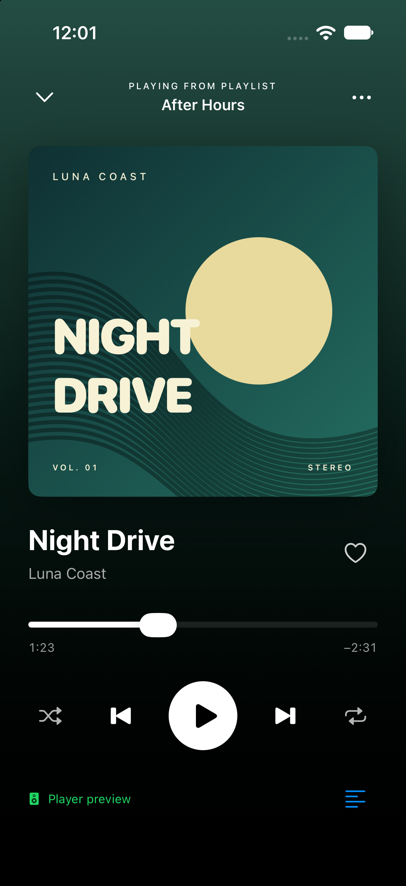

# Music Player Practice

A first draft for iOS Bootcamp Project 1, inspired by Spotify. I will keep learning and updating it.

## Run

Open `SpotifyPlayer.xcodeproj` in Xcode. Choose the `SpotifyPlayer` scheme and an iPhone simulator, then press Run. You can also use `My Mac (Mac Catalyst)` for a desktop preview.

## In this draft

- Album cover, song details, and a progress slider.
- Play/pause, favorite, shuffle, and repeat state changes.
- Time labels that update when the slider moves.

This is a UI practice app; it does not play audio.

## Where to edit

- `ContentView.swift`: song details, background, and spacing.
- `PlaybackControlsView.swift`: buttons and state.
- `AlbumArtworkView.swift`: the cover.

Built with SwiftUI. iOS and Mac builds pass. Also launched and checked on an iPhone 17 simulator running iOS 27.

The initial draft was made with help from Codex and will be revised.

[Project 1 instructions](https://appteamcarolina.notion.site/Project-1-9d6c96c1ce73835bbe00814a83ee1c27)

## Screenshot

